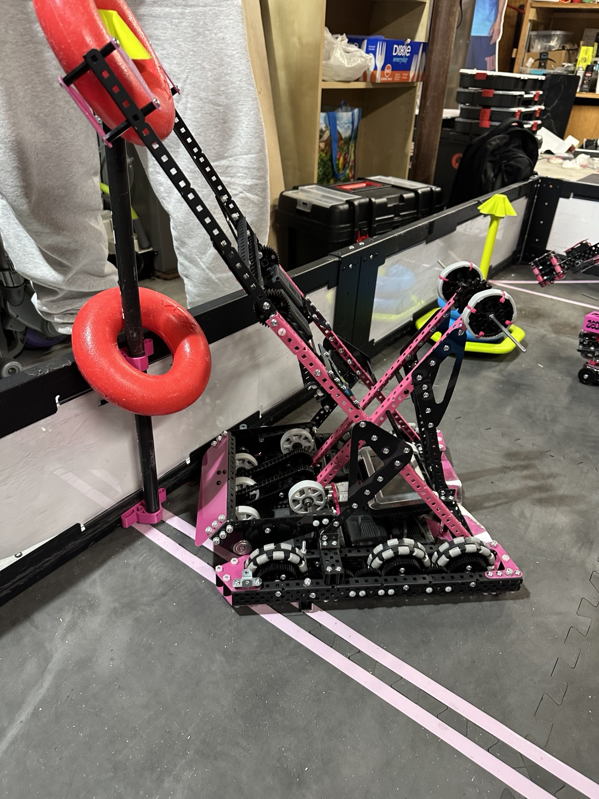
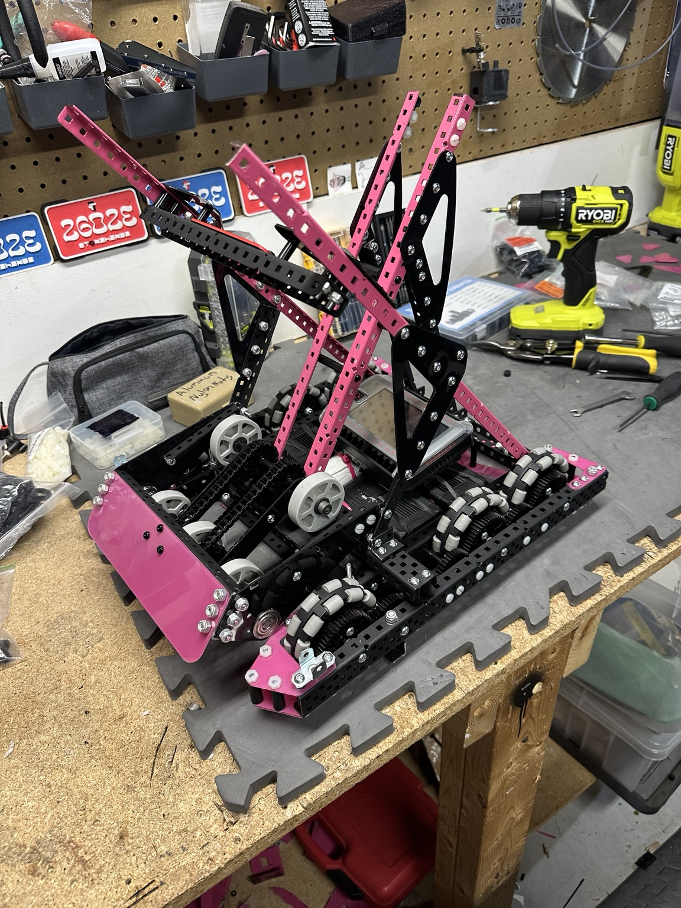
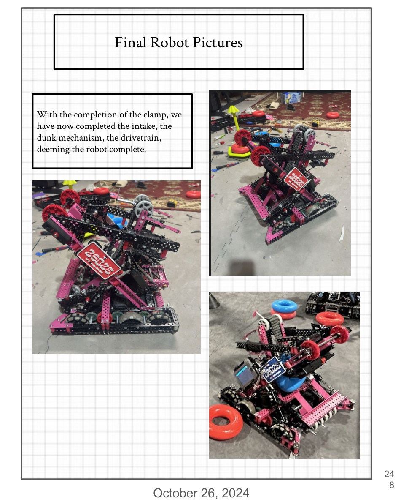
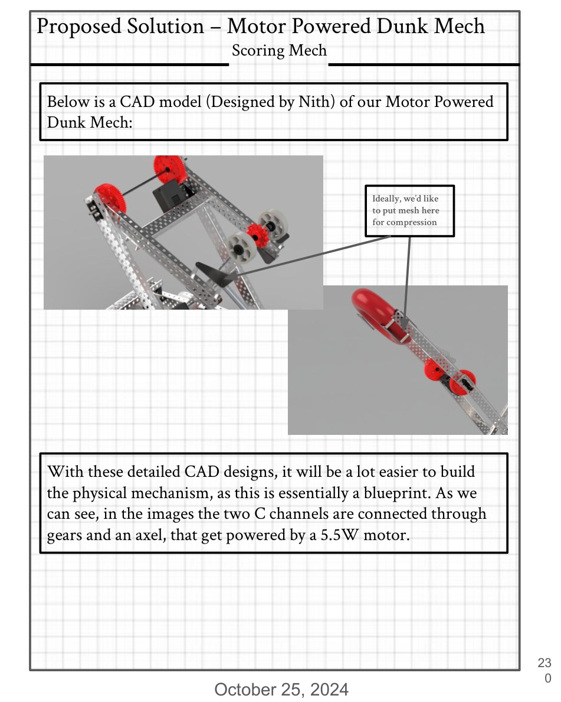
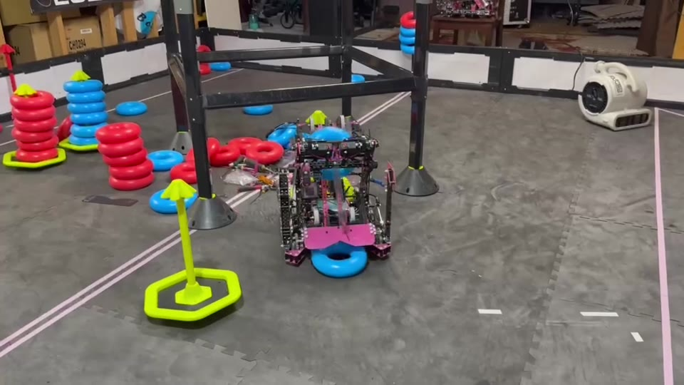
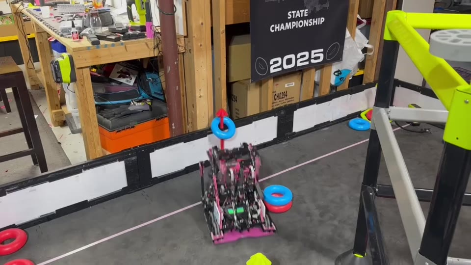
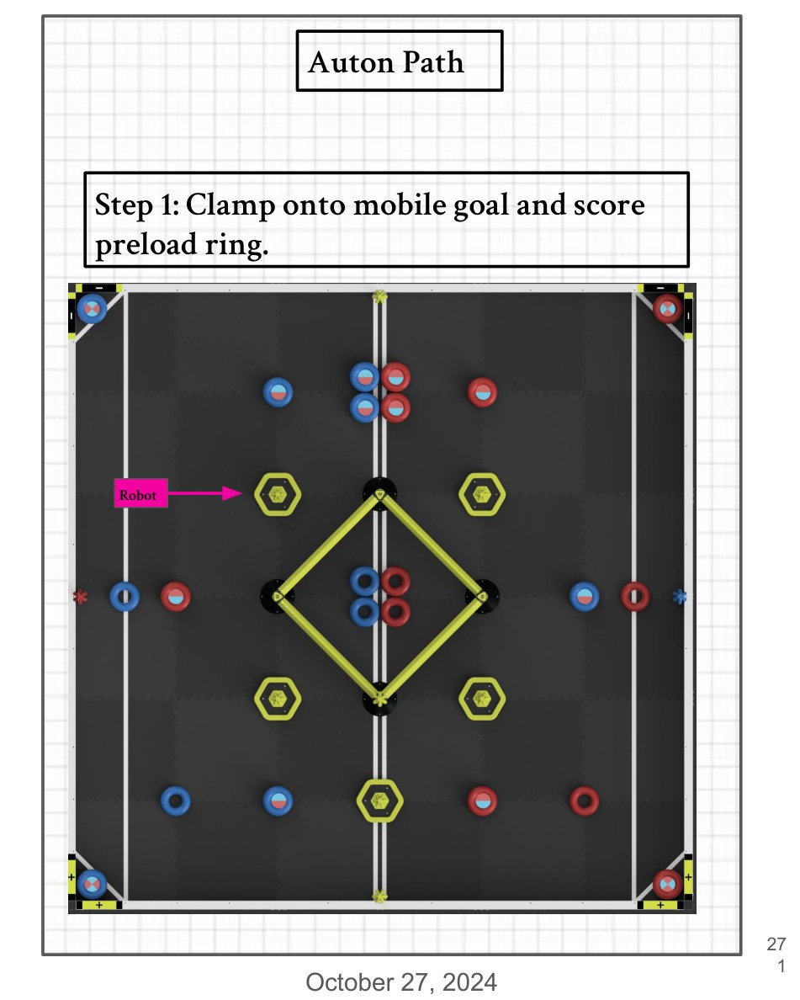

# Team 2602E — VEX V5 Robotics: High Stakes

**Hopkinetics Entropy · Hopkinton High School · 2024–2025 VEX V5 Robotics Competition**

A competition robotics project encompassing mechanical design, autonomous-motion development, sensing, drivetrain engineering, iterative prototyping, match strategy, and field-tested systems integration. This repository preserves Team 2602E's original engineering notebook, worlds-era Fusion 360 robot assembly, physical robot photographs, and selected autonomous-path demonstration videos. **The original VEXcode C++ project has now been recovered and is available under [`code/ragar/`](code/ragar/).**



*High Stakes robot with ring intake, raised scoring structure, mobile-goal mechanisms, and omnidirectional wheel assemblies.*

## Competitive achievements

| 2024–2025 season | Team 2602E performance |
|---|---|
| **Massachusetts State Championship** | **Excellence Award** |
| **Tournament Championships** | **4** |
| **Awards won** | **7** |
| **Season qualification record** | **49 W · 20 L · 3 T** |
| **Qualification win rate** | **68.1%** (49 wins / 72 matches) |
| **World Championship** | **2025 Dallas · Spirit Division · 7 W / 3 L in qualifications** |
| **Competitions attended** | **10** |

These statistics refer to the **2024–2025 High Stakes season only**, not other years. Win rate counts ties in the total match count; it does not treat ties as wins. See the [award-by-award results and public sources](competition/results.md).

## Robot engineering

The machine evolved through substantial design iteration, including a mechanical rebuild during the fall season. The engineering notebook documents design selection, fabrication, mechanism comparisons, programming investigations, and observed tradeoffs. Rather than claiming a single unchanging design, the documentation distinguishes the earlier builds from the later worlds-era Fusion assembly.



### Principal subsystems

| Subsystem | Engineering focus |
|---|---|
| Drivetrain | VEX V5 motors, gearing, wheel selection, packaging, motion control and repeatability |
| Ring intake | Multi-stage roller and guide geometry, consistent ring acquisition, routing to scoring components |
| Scoring mechanisms | Iterative hook, hood, and elevated scoring concepts, with documented testing and revisions |
| Mobile-goal handling | Clamp architectures and mechanical leverage tradeoffs, assessed during the rebuild |
| Autonomous motion | Path planning, PID control, pure-pursuit concepts, odometry analysis and tuning investigations |
| Integration | CAD-driven geometry, V5 hardware, electrical packaging, field constraints and competition strategy |

The notebook discusses control algorithms and candidate designs. It is **not proof that every described algorithm or prototype mechanism appeared in the final robot firmware**; the recovered code is a historical project snapshot, not an independently verified record of the exact firmware deployed in every competition.

## Editable CAD assembly

The original worlds-era Fusion 360 robot archive is included as a native, editable design:

**[Download the full Fusion assembly — `2602e-worlds-robot.f3z`](cad/2602e-worlds-robot.f3z)**

Because the 129 MiB model exceeds GitHub's regular file limit, the repository tracks it with **Git LFS**. Use `git lfs pull` after cloning if the CAD data is not automatically downloaded. The `.f3z` retains linked Fusion components.

For background, the design notebook includes the preceding mechanism iterations:

| October 2024 build photographs | Rebuild-era scoring mechanism concept |
|:---:|:---:|
|  |  |

*Original notebook page reproductions; not substitutes for the later worlds-era CAD archive.*

## Autonomous demonstrations

The following videos show the robot operating on a High Stakes field during autonomous-path demonstrations. They are selected recordings, not a standardized benchmark dataset or a claim of a measured autonomous success rate.

| Demonstration 1 | Demonstration 2 |
|:---:|:---:|
| [](media/autonomous/autonomous-path-1.mp4) | [](media/autonomous/autonomous-path-2.mp4) |
| [Watch autonomous path 1](media/autonomous/autonomous-path-1.mp4) | [Watch autonomous path 2](media/autonomous/autonomous-path-2.mp4) |

### Autonomous programming and control documentation

The [engineering notebook](docs/2602e-high-stakes-engineering-notebook.pdf) contains material on:

- PID control and tuning, with alternative gains for different motion scenarios.
- Trajectory generation and pure-pursuit path following.
- Odometry and autonomous-route planning.
- Algorithm analysis and tuning experiments, including particle swarm optimization.
- Reliability considerations, logging, hardware temperature management and motion recovery.

The recovered original VEXcode source tree is available at **[`code/ragar/`](code/ragar/)**, including the project configuration, original `src/` and `include/` directories, autonomous routines, and drivetrain/control experiments. See the [source archive notes](code/README.md) for provenance, third-party components, and reproduction limitations.



## 371-page engineering notebook

**[Read or download the complete 2602E Digital Engineering Notebook](docs/2602e-high-stakes-engineering-notebook.pdf)**

The full chronological engineering record covers:

1. **Game analysis and strategy:** High Stakes scoring opportunities, match constraints, initial performance priorities.
2. **Mechanical design:** Drivetrain alternatives, intake designs, scoring solutions, wall-stake alignment, mobile-goal clamp experiments.
3. **Controls and software investigations:** PID, particle swarm optimization, path planning, pure pursuit, code structure, and troubleshooting.
4. **Prototyping and rebuild:** Component evaluations, selection matrices, revised geometry, final robot photographs.
5. **Tournament retrospectives:** Competition performance, observed problems, and changes to the robot and strategy.

The notebook is an original team document, not a retrospective reconstruction. Selected images on this page are reproduced from it to make the portfolio easier to browse.

## Project archive

```text
2602e-high-stakes/
├── cad/                 Native Fusion 360 worlds-era assembly (Git LFS)
├── code/ragar/          Recovered original VEXcode C++ project (68 source/config files)
├── competition/         Season records and awards
├── docs/                Complete 371-page engineering notebook
└── media/
    ├── photos/          Original robot photographs
    ├── autonomous/      Selected autonomous videos and thumbnails
    └── engineering-notebook/ Selected notebook visuals
```

## Team and provenance

This work was completed as a **team project by VEX V5 Robotics Competition Team 2602E, Hopkinetics Entropy, at Hopkinton High School** during the 2024–2025 High Stakes season. The repository documents the full team's engineering work without assigning specific mechanisms or code to individual members.

**Competition data:** [RobotEvents team profile](https://www.robotevents.com/teams/V5RC/2602E) and [archived season results](https://events.vex.wang/team.php?id=73754). VEX and High Stakes are names of their respective owners; this is a team engineering portfolio, not an official VEX software product.
